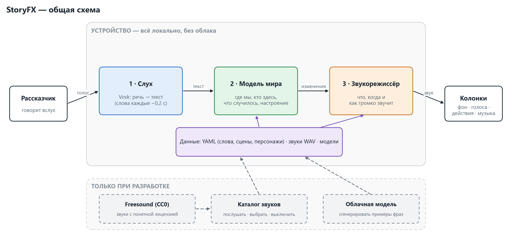
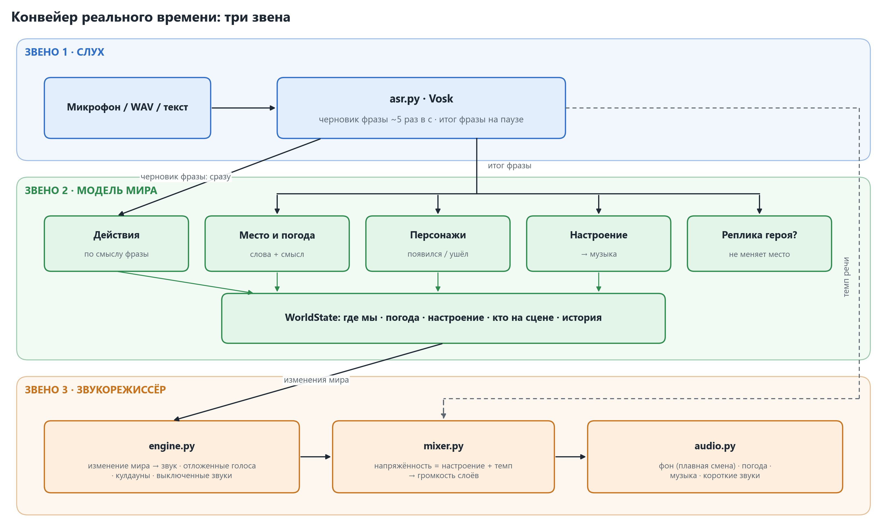
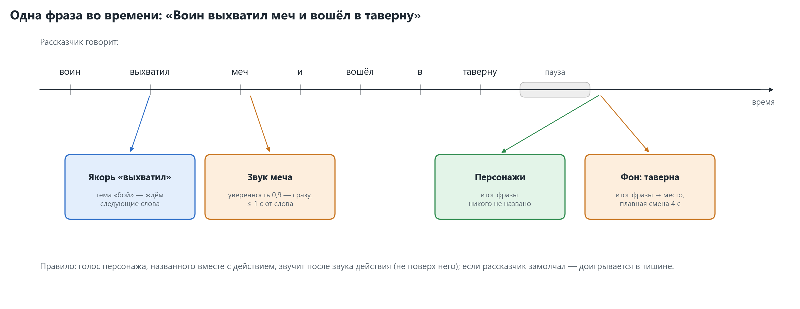
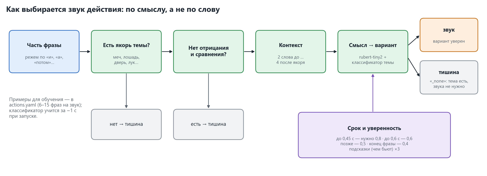
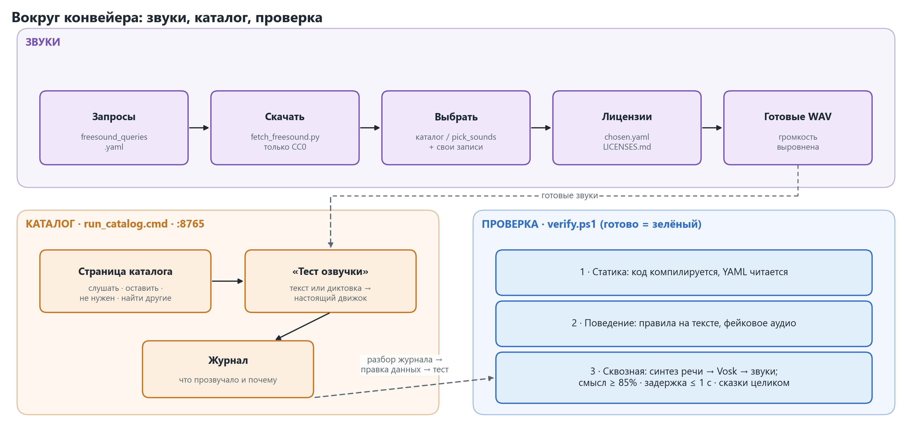
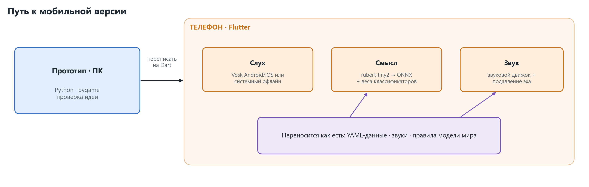

# StoryFX — архитектура решения

Обзор целиком (то же с картинками для печати — [StoryFX-architecture.docx](StoryFX-architecture.docx); схемы рисует `docs/img/make_diagrams.py`): что делает система, из каких частей состоит, как идут данные и где границы. Подробности кода прототипа — [architecture.md](architecture.md), решения и их причины — [DECISIONS.md](../DECISIONS.md).

## 1. Задача и жёсткие ограничения

Рассказчик (ведущий ДнД, родитель со сказкой) говорит вслух — система **в реальном времени** подкладывает звук: фон места, погоду, голоса персонажей при появлении, звуки действий, музыку по настроению.

| Ограничение | Следствие для архитектуры |
|---|---|
| Всё локально (D-001) | распознавание речи и модель смысла — на устройстве; облако — только инструмент разработчика |
| Голос не сохраняется | аудио живёт только в буфере распознавателя; на диск и в сеть — только текст журнала |
| Звук действия ≤ 1 с от конца слова (D-011) | решение по **частичному** тексту распознавания, не дожидаясь конца фразы |
| Режимов нет (D-010) | один набор данных для сказок и ДнД; громкость и плотность звука подстраивает «звукооператор» |
| Только лицензированные звуки | Freesound CC0 / свои записи / синтез; лицензия каждого файла — в `LICENSES.md` |
| Данные отдельно от кода | слова, сцены, персонажи, примеры — в YAML; код их не знает |

## 2. Схема контекста

Пунктир — то, чего в работающем приложении нет: звуки и обучающие примеры готовятся заранее и попадают в данные.

## 3. Конвейер реального времени: три звена (D-011)

**Почему так.** Наблюдатели только *наблюдают* («назван медведь», «похоже на лес»), а решает мир: был ли медведь уже на сцене, не ушёл ли, не та же ли сцена. Звукорежиссёр видит только изменения мира и решает, *как* это прозвучит: сейчас или после звука действия, громко или тихо, не выключен ли звук. Новый вид звука = новый наблюдатель + реакция режиссёра, остальное не трогается.

## 4. Одна фраза во времени

## 5. Как принимаются решения (смысл, а не слово)

| Наблюдатель | Механизм | Данные |
|---|---|---|
| Действия | якорь → классификатор по смыслу (обучается при запуске за ~1 с) | `actions.yaml`: 28 тем, 49 звуков, у каждой темы `_none` |
| Место, погода | ключевое слово места — сразу; иначе близость окна текста к описаниям + гистерезис (порог, отрыв, подтверждения, выдержка); «вдали», «отмычка» — не место | `scenes.yaml`: 15 сцен, 6 слоёв погоды |
| Настроение | тот же трекер; рост напряжения — без выдержки | `moods.yaml`: 4 настроения → 4 музыкальные петли |
| Персонажи | имя → «вошёл», если его не было; глагол ухода → «ушёл»; «я ушёл» — уходит говорящий | `characters.yaml`: 59 персонажей |
| Реплика героя | кавычки/тире (текст) или признаки речи (голос) | `speech.yaml` |

## 6. Данные и модели при запуске

| Модель | Размер | Роль | Замечание |
|---|---|---|---|
| Vosk small-ru-0.22 | ~45 МБ | слух в приложении | ошибки слов ~25%; 4 из 85 проверок сказок голосом не проходят — только из-за слуха |
| Vosk ru-0.42 | ~1,8 ГБ | «эталонный слух» для сравнения (`compare_asr.py`) | ошибки слов ~8%, 85 из 85 |
| rubert-tiny2 | ~120 МБ | смысл фраз (действия, сцены, настроение) | не дообучена; поверх — свои классификаторы |

## 7. Вокруг конвейера: инструменты и проверка

Цикл улучшения: владелец пробует «Тест озвучки» → журнал → разбор (что прозвучало зря / не прозвучало) → правка данных или правил → случай становится тестом → verify.ps1.

## 8. Потоки и время

Сейчас всё в одном потоке: распознавание ждёт модель смысла (на каждом partial с якорем — вектор rubert-tiny2), плюс фоновый «тикер» в `cli.py`, доигрывающий отложенные голоса в тишине. Цель (задача 20): три потока с очередями — **аудио → распознавание → смысл и модель мира → звукорежиссёр** (звук, микс, тик).

Бюджет задержки звука действия: слово сказано → Vosk отдаёт его 0,2–0,6 с → решение 0–0,6 с (ступени уверенности) → звук. Худшая измеренная — 1,00 с (на TTS; на живой речи не измерена).

## 9. Путь к мобильной версии

Переносится без изменений: данные (YAML), звуки, правила модели мира. Переписывается: код конвейера (Dart), аудио, потоки. Остаются открытыми выбор модели слуха (маленькая ошибается, большая — 1,8 ГБ) и эхо из динамика телефона.

## 10. Известные слабые места и что с ними делать

| Слабое место | Пример | Направление |
|---|---|---|
| Слух маленькой модели | «в гору» → «в городе» → сцена город | словарь/языковая модель Vosk под сказки и ДнД; выбор модели для телефона |
| Сцена по смыслу грубая | «воротился старик ко старухе» — без ключевого слова дом не узнавался | 2026-11-22 (задача 25): показатель на 9 размеченных сказках (`tools/scene_eval.py`) и классификатор сцены по фразе (`data/scene_examples.yaml`): текстом 72% → 86%, на контрольной сказке 62% → 76%, голосом 63% → 69%. Дальше: больше примеров (сейчас 3–28 на сцену); дообучение rubert-tiny2 — если не хватит |
| Звуки выбраны по названию | часть звуков не слушали | каталог: владелец слушает, переизбирает, «Не нужен» |
| Один поток | распознавание ждёт смысл | задача 20 |
